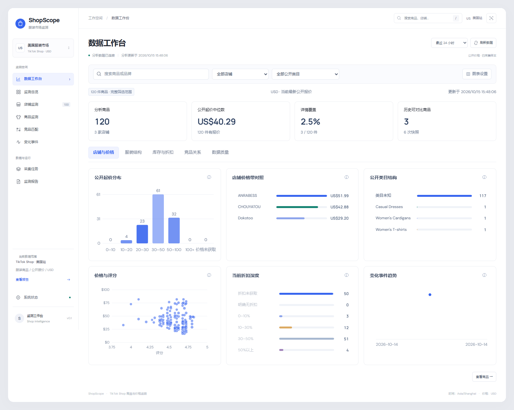

<p align="center">
  
</p>

<h1 align="center">ShopScope</h1>

<p align="center">
  <strong>TikTok Shop 服装商品价格与竞品监测平台</strong><br>
  从店铺发现、商品与 SKU 采集，到历史快照、变化事件和可解释的数据分析。
</p>

<p align="center">
  
  
  
  
  
</p>

<p align="center">
  <a href="#功能一览">功能一览</a> ·
  <a href="#界面预览">界面预览</a> ·
  <a href="#快速启动">快速启动</a> ·
  <a href="#技术架构">技术架构</a> ·
  <a href="#文档导航">文档导航</a>
</p>

---

ShopScope 面向 TikTok Shop 美国站服装场景，将分散的公开店铺、商品、规格和价格观察整理成可查询、可比较、可追溯的数据。你可以从价格带找到商品，查看颜色与尺码结构，追踪已观察到的价格和库存变化，并在人工确认同款与 SKU 后比较竞品价格。

当前版本提供完整的 Python 后端、中文 Web 工作台、任务调度与容器部署配置。前端由 FastAPI 直接提供，无需单独安装 Node.js 或构建前端。

> **开始前**：当前适配范围为美国站、USD、公开报价。采集任务与周期监测默认关闭，启动界面不会自动抓取网站。仓库包含源码和公开种子名单，业务数据库、登录凭据、采集缓存与运行报告需在自己的环境中生成。

## 功能一览

| 能力 | 可以做什么 |
| --- | --- |
| 数据分析工作台 | 查看价格分布、店铺价格带、评分散点、折扣和类目结构；点击图表下钻到对应商品 |
| 服装结构分析 | 按颜色、尺码、面料、风格、季节和品牌分析商品，查看颜色与尺码矩阵 |
| 店铺与商品监测 | 从公开入口解析店铺身份，发现分页商品，查询商品详情、真实图库与 SKU 规格 |
| 历史快照与事件 | 保留商品和 SKU 的观察历史，比较价格、缺货、补货、折扣与规格变化 |
| 竞品关系管理 | 提供规则候选，人工确认同款和精确 SKU 映射，保存与撤销关系，展示可比规格的价差 |
| 采集任务管理 | 使用租约、心跳、重试、检查点与队列背压管理任务，查看执行状态和失败原因 |
| 报告与可观测性 | 导出 HTML、Markdown、JSON 报告，提供健康检查、Prometheus 指标和告警配置 |

分析工作台还展示字段覆盖、图片覆盖、详情新鲜度与历史跨度，便于判断某项结论有多少实际数据支撑。

## 界面预览

**数据工作台**：从公开报价、店铺、类目与变化趋势进入商品明细。



截图来自本地运行的真实样本界面，截图中的数量与覆盖率仅代表当时的已采集数据。新部署使用空数据库时，不会自动出现这些商品和历史记录。

## 快速启动

### 1. 安装项目

本地运行需要 **Python 3.11+** 和 **MySQL 8.0.16+**。以下命令使用 Windows PowerShell；Linux / macOS 将 `.\.venv\Scripts\python.exe` 换为 `.venv/bin/python`。

```powershell
git clone https://github.com/2185359703/tiktok-shop-monitor.git
cd tiktok-shop-monitor

python -m venv .venv
.\.venv\Scripts\python.exe -m pip install -r requirements.txt
```

### 2. 配置数据库

首次配置时复制示例文件：

```powershell
if (-not (Test-Path -LiteralPath .env)) {
    Copy-Item -LiteralPath .env.example -Destination .env
}
```

编辑 `.env` 中的 `DATABASE_URL`，填写自己的 MySQL 用户名、密码、地址与数据库名。密码包含 `@`、`:`、`/` 或 `#` 时，需要先做 URL 编码。首次建库需要该账号具有对应权限。

```powershell
.\.venv\Scripts\python.exe -m app.storage.schema --create-database
```

已有空数据库可省略 `--create-database`。已有业务库升级请参考[增量迁移说明](docs/analytics-workbench.md#增量启用)，不要用旧版 SQL 覆盖现有结构。

### 3. 启动工作台

```powershell
.\.venv\Scripts\python.exe -m scripts.run_api
```

| 入口 | 地址 |
| --- | --- |
| Web 工作台 | <http://127.0.0.1:8000/> |
| 交互式 API 文档 | <http://127.0.0.1:8000/docs> |
| 数据库就绪检查 | <http://127.0.0.1:8000/health/ready> |
| Prometheus 指标 | <http://127.0.0.1:8000/metrics> |

只读工作台与已有数据查询只需要 MySQL。Scheduler / Worker 的正常执行还需要 RabbitMQ 与 Redis，具体配置见[运行指南](docs/runtime-guide.md)。

<details>
<summary><strong>使用 Docker Compose 启动独立环境</strong></summary>

安装 Docker Engine / Docker Desktop 与 Compose 插件后，在项目根目录复制配置：

```powershell
if (-not (Test-Path -LiteralPath deployment.env)) {
    Copy-Item -LiteralPath .env.docker.example -Destination deployment.env
}
```

先编辑 `deployment.env`，替换示例密码，并同步修改连接 URL 中的对应密码。初次启动可保持 `ENABLED_TASK_TYPES` 为空。

```powershell
docker compose --env-file deployment.env config --quiet
docker compose --env-file deployment.env up -d --build
docker compose --env-file deployment.env ps
```

容器栈包含 API、Scheduler、Worker、MySQL、RabbitMQ、Redis、Prometheus 和一次性建表服务。数据库使用独立命名卷，不会自动复制本机数据；种子也不会自动导入。

工作台地址仍为 <http://127.0.0.1:8000/>。RabbitMQ 管理页为 <http://127.0.0.1:15672/>，Prometheus 为 <http://127.0.0.1:9090/>。保留数据时，不要执行带 `-v` 的 Compose 删除命令。

</details>

## 开始采集与监测

仓库提供一份 100 家美国站服装店铺的[公开种子名单](data/seed/README.md)，保留入口核验日期、来源与替换记录。链接核验是历史观察，站点入口可能随时间变化。

先验证文件，再按需要导入自己的数据库：

```powershell
.\.venv\Scripts\python.exe -m scripts.seed_shops --dry-run
.\.venv\Scripts\python.exe -m scripts.seed_shops
.\.venv\Scripts\python.exe -m scripts.run_worker --check
```

种子导入保存观察和初始任务，不会直接完成商品采集。接下来在 `.env` 中配置 `RABBITMQ_URL`、`REDIS_URL`，并按[运行指南](docs/runtime-guide.md)显式选择 `ENABLED_TASK_TYPES`，分别启动：

```powershell
# 终端 1：调度到期任务并发送通知
.\.venv\Scripts\python.exe -m scripts.run_scheduler

# 终端 2：领取并执行已启用的任务
.\.venv\Scripts\python.exe -m scripts.run_worker
```

处理器支持 `shop_discovery`、`product_discovery`、`product_detail`、`product_snapshot`、`change_detection` 和 `report_generation`。周期监测还需要在 `configs/settings.toml` 中设置明确的商品名单与周期开关。

仅导出已有数据库中的观察结果：

```powershell
.\.venv\Scripts\python.exe -X utf8 -m scripts.export_report
```

报告保存到 `data/exports/reports/`。详细流程见[商品发现](docs/product-discovery.md)、[详情与 SKU](docs/product-detail.md)、[历史监测](docs/snapshot-monitoring.md)和[报告说明](docs/monitoring-reports.md)。

## 技术架构

项目将页面查询、任务调度与采集执行分成独立进程，业务数据和任务状态统一保存在 MySQL。

| 层次 | 实现 | 职责 |
| --- | --- | --- |
| Web 界面 | HTML / CSS / JavaScript、SVG 图表 | 中文工作台、筛选下钻、商品详情和竞品关系交互 |
| API 控制面 | FastAPI、Uvicorn | 数据查询、受控写入、任务接口、报告下载与健康检查 |
| 业务与存储 | SQLAlchemy 2、PyMySQL、MySQL 8 | 店铺、商品、SKU、图片、快照、关系与持久化任务 |
| 调度与执行 | Scheduler、Worker、RabbitMQ | 到期扫描、消息通知、租约领取、心跳、重试与恢复 |
| 请求协调 | Redis、HTTPX、curl_cffi | 共享请求间隔、访问暂停与公开页面读取 |
| 部署与监控 | Docker Compose、Prometheus | 独立服务编排、持久卷、指标与告警 |

RabbitMQ 传递任务通知，MySQL 保存任务状态与结果。Worker 核验租约并提交业务事务后才确认消息，通过幂等写入处理重复投递；Redis 用于共享限速与短期去重。更多设计见[系统架构](docs/architecture.md)和[任务状态流转](docs/task-flow.md)。

```text
app/
  frontend/       中文 Web 工作台与本地字体
  api/            查询、任务、图片、匹配与报告接口
  crawlers/       公开页面读取与解析
  services/       采集、快照、事件、分析与匹配服务
  models/         SQLAlchemy 数据模型
  queue/          RabbitMQ、Redis 与重试策略
  workers/        租约与心跳驱动的任务执行
  reports/        报告汇总、缓存与多格式导出
configs/          非敏感运行配置
data/seed/        公开店铺种子与来源说明
deployment/       服务器部署与运行辅助工具
migrations/       数据库结构与增量 SQL
monitoring/       Prometheus 与告警规则
scripts/          建表、导入、采集、导出和诊断入口
tests/            解析、API、存储与任务链路检查
docs/             使用指南、设计说明与历史验证记录
```

## 配置说明

连接信息与密钥放在本地环境变量或被 Git 忽略的 env 文件中。环境变量优先；同时存在 `.env` 与 `tiktok-shop-monitor.env` 时，仅加载 `.env`。普通运行参数在 `configs/settings.toml` 中配置。

| 配置 | 用途 | 默认行为 |
| --- | --- | --- |
| `DATABASE_URL` | MySQL 业务数据库 | 需要自行配置 |
| `RABBITMQ_URL` / `REDIS_URL` | 调度、通知和共享请求闸门 | 执行采集任务前配置 |
| `API_TOKEN` | Bearer Token 写入鉴权 | 未配置时关闭写接口；启用时至少 24 字符 |
| `ENABLED_TASK_TYPES` | 允许执行的任务类型 | 空，采集默认关闭 |
| `API_HOST` / `API_PORT` | API 监听地址 | `127.0.0.1:8000` |
| `SETTINGS_FILE` | TOML 配置路径 | `configs/settings.toml` |
| `periodic_snapshots_enabled` / `monitored_product_ids` | 周期快照与显式监测名单 | 关闭，名单为空 |

读取接口默认面向本机或可信网络，不能把公开源码仓库理解为可直接暴露的公共数据服务。对外部署需要配置鉴权、TLS 与网络访问控制。

## 开发与验证

```powershell
.\.venv\Scripts\python.exe -m pip install -e ".[test]"
.\.venv\Scripts\python.exe -m pytest -q
.\.venv\Scripts\python.exe -m app.storage.schema --check-sql migrations/current_schema.sql
```

未设置 `MYSQL_TEST_URL`、`REDIS_TEST_URL` 时，对应基础设施检查会跳过。MySQL 集成检查只接受本机、尚不存在且名称以 `tiktok_shop_monitor_test_` 开头的专用测试库；不要将业务库用于测试。

源码中保留解析、字段语义、幂等写入、任务恢复、API 和前端检查。历史实跑记录可以在文档中查看，其中的日期、数据量和执行结果是当时的观察，不代表当前站点覆盖或持续运行承诺。

## 数据口径与当前范围

- **价格**：保留商品价格范围和 SKU 单价，只在币种、公开报价上下文与规格可比时计算价差。
- **未知值**：缺失库存、销量或评分保持 `NULL / unknown`；缺失值不替换为零。
- **变化事件**：基于有效历史观察比较。首次发现不等同于平台上架，访问失败不等同于下架或缺货。
- **覆盖范围**：工作台描述已采集样本，店铺采样和公开累计销量不用于推算全市场排名、近期销量或 GMV。
- **采集范围**：当前使用公开购物页面与匿名可访问数据，不要求 TikTok 登录。页面结构、地区响应和访问限制可能影响采集结果。
- **版本状态**：当前为 `0.1.0`，已包含部署与实跑记录；长期稳定性、完整店铺覆盖与更多市场支持需要按实际结果验证。

## 文档导航

| 想了解什么 | 文档 |
| --- | --- |
| 启动、环境配置、Docker 与 API | [运行指南](docs/runtime-guide.md) |
| 界面、分析口径、图片与竞品匹配 | [前端工作台](docs/frontend.md) · [分析工作台](docs/analytics-workbench.md) |
| 系统如何组织，任务如何恢复 | [架构设计](docs/architecture.md) · [任务流转](docs/task-flow.md) |
| 种子来源、导入与店铺核验 | [种子说明](data/seed/README.md) · [种子导入](docs/seed-discovery.md) · [入口核验](docs/seed-link-verification.md) |
| 商品发现、分页与 SKU 补全 | [商品发现](docs/product-discovery.md) · [商品详情](docs/product-detail.md) |
| 历史价格、库存事件与周期监测 | [快照与变化检测](docs/snapshot-monitoring.md) |
| 报告口径、导出与下载 | [报告说明](docs/monitoring-reports.md) |
| 表结构、字段语义与迁移 | [数据字典](docs/data-dictionary.md) · [当前 SQL](migrations/current_schema.sql) |
| 部署经验与故障验证记录 | [服务器部署](docs/server-deployment.md) · [队列联调](docs/queue-integration.md) |

---

<p align="center">ShopScope · 让每一次价格与库存观察，都有可追溯的依据。</p>
