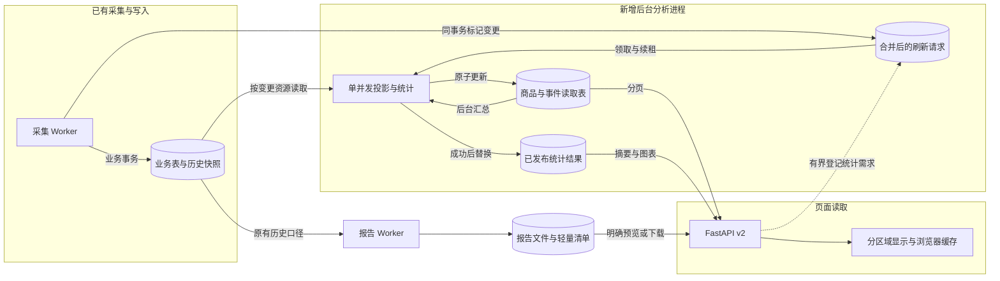

# ShopScope 页面加载性能设计

状态：核心读取链路已实现，生产启用与性能验收待执行。日期：2026-10-15，Asia/Shanghai。

本文保留设计时的方案与合同；实际代码、异步运行方式和启用步骤见 [实施说明](page-loading-implementation.md)。

目标是让页面读取已经整理好的小份数据：商品和事件按页返回，图表读取后台统计结果，各区域独立显示。现有 FastAPI、MySQL、原生 JavaScript 前端继续使用。本文中的 v2 接口、读取表、分析进程和配置项都是拟新增设计，尚未部署。

优先实施两个改动：普通页面退出完整报告加载链路；商品分页接口退出全范围统计链路。完整历史报告继续后台生成，保留历史截止时间和证据口径。

## 1. 已确认的基线

以下数据来自本次会话上一轮的线上只读检查，不是持续监控、浏览器完整加载时间或压力测试。结构化记录见 [基线证据](evidence/page-loading-baseline-20261015.json)。

| 证据 | 观察 | 结论 | 对应设计 |
| --- | --- | --- | --- |
| E1 | `refresh()` 等待 overview、report、shops、capabilities 全部结束；线上前端也存在同一逻辑 | 一个慢资源阻止多个页面显示已返回的数据 | 页面资源独立加载，取消全局数据等待门槛 |
| E2 | `/overview` 单次 15.153 秒；商品首屏 24 条在 20.016 秒内无首字节 | 小响应也有明显后端等待 | 拆出任务统计、字段覆盖率和 SKU 汇总，缩短列表查询 |
| E3 | 完整报告未压缩长度 40,444,471 字节；请求在 45.003 秒停止，仅收到 443,696 字节 | 整份报告不适合作为页面公共状态 | 页面返回摘要，完整报告仅供明确的预览与下载 |
| E4 | 缓存只有一个 `_entry` 和一个 `_inflight`；过期先清旧结果，再同步构建 | 不同筛选互相替换缓存，未命中时请求排队 | 每个查询独立保存结果，刷新期间继续服务上一版本 |
| E5 | 2 vCPU、约 4 GiB 主机，单次 load average 为 9.37 / 10.17 / 8.05 | 资源竞争可能放大延迟，具体占比尚未拆分 | 后台统计单并发，批量处理，限制重复计算 |

E3 是未压缩响应长度，不能等同于浏览器压缩后的传输量。另一条启用压缩的请求在 25.008 秒内没有首字节，未测得压缩比。MySQL 元数据估计约 3.8 万商品、67.5 万当前 SKU 和 68.1 万 SKU 快照；这些是容量线索，不是精确业务数量。

主要源码依据：[前端调度](../app/frontend/app.js)、[分页与工作台统计](../app/services/analytics_service.py)、[报告构建](../app/reports/summary.py)、[缓存](../app/reports/cache.py)。线上分析服务和报告构建文件的摘要与本地一致。线上工作台缓存 TTL 当时为 120 秒，本地当前文件为 30 秒；本文不依赖两者相等。

## 2. 数据流与责任



图表假设：初期继续单机部署，一份分析进程，MySQL 保存可恢复的派生数据。可编辑图源见 [page-loading-data-flow.mmd](diagrams/page-loading-data-flow.mmd)。

API 请求内只做索引分页、读取已发布统计和有界的刷新登记。API 不构建全市场 SKU 临时表、不扫描全部历史快照、不生成完整报告。队列登记仅涉及派生统计，不创建网站采集任务。

后台分析采用单独进程 `scripts.run_analytics` 和自己的持久刷新表。继续复用项目配置、SQLAlchemy、日志与部署方式；首期不增加 `CrawlTask` 枚举、修改既有消息协议或占用网站 Worker 的消费线程。理由是当前采集任务类型、资源类型、租约及数据库约束相互关联，而派生统计更适合按资源合并更新。

现有 Redis 保持采集闸门和去重用途。初期查询缓存由 MySQL 统计结果加 API 进程内有界缓存组成。若以后增加多 API 实例，再评估独立 Redis 缓存实例；不同 Redis DB 编号仍共享内存和淘汰策略，不能当成资源隔离。

## 3. 每个页面的加载合同

| 页面 | 首屏必须的数据 | 可独立补充的数据 | 解除的依赖 |
| --- | --- | --- | --- |
| 市场总览 | 已发布的历史观察口径摘要与主要图表 | 最近 5 条事件、监测质量 | 完整报告商品数组、任务全量统计 |
| 数据工作台 | 当前主题的统计结果 | 其他主题、竞品关系、图表明细 | 未打开主题的计算与关系请求 |
| 店铺监测 | 当前页店铺档案 | 同范围店铺样本统计 | 完整报告、全部商品 |
| 商品监测 | 24 条商品、封面、已汇总 SKU 数 | 精确总数、字段覆盖率、图片覆盖率 | 翻页时重算全范围覆盖率 |
| 竞品匹配 | 当前页已确认关系 | 候选建议、关系统计 | 等候候选生成后才显示关系 |
| 变化事件 | 当前页历史事件 | 同筛选的事件数量和趋势 | 报告内最多 1,000 条事件的浏览器筛选 |
| 采集任务 | 当前页任务 | 短期缓存的状态数量 | `overview` 完成后才请求任务 |
| 监测报告 | 已完成报告清单、生成中任务 | 选中报告的摘要 | 打开页面即时生成整份报告 |

商品详情先显示基本资料和封面；规格、历史按页独立读取，介绍在打开对应标签时读取。一个资源失败不遮住其余资源。所有页面保留现有信息层级与视觉风格，调整加载和刷新状态。

## 4. 四张派生表

以下为字段与约束设计，不是已执行的迁移 SQL。派生表可从业务数据重建；业务商品、快照和任务继续作为事实来源。

### 4.1 `product_read_models`

主键为 `(schema_version, basis, product_id)`。`basis` 固定为 `current` 或 `latest_valid_snapshot`，每个商品每个版本最多两行。

| 字段组 | 内容与约束 |
| --- | --- |
| 作用域 | `platform, region, currency, pricing_context, product_id, shop_id, platform_product_id`；禁止跨作用域关联 |
| 常用列表字段 | 标题、URL、原始与规范类目、品牌、性别、季节、风格、材质、评分、评价数、公开累计销量及原文；保持当前空值语义 |
| 价格与库存 | 原有 DECIMAL 精度、价格上下限、折扣、库存与可访问状态；价格类型按现有规则派生 |
| 已观察 SKU | `sku_count, sku_in_stock, sku_out_of_stock, sku_unknown, sku_partial`；仅统计该口径真实观察到的 SKU |
| 规格汇总 | 颜色、尺码标签与按颜色/尺码合并的 `sku_cells` JSON；保存完整计数，展示时才应用既有矩阵上限 |
| 图片与覆盖 | 首图 URL、缩略图 URL、图片观察时间、字段存在性标记；不复制相册和商品介绍正文 |
| 历史质量 | 有效快照数量、不同观察时刻数量、最早/最近观察时间；用于历史跨度和重复观察统计 |
| 版本与时间 | `applied_revision, source_fingerprint, source_snapshot_id, observed_at, media_observed_at, projected_at`；源 ID 在 API 中仍为字符串 |

`current` 复用 `observed_sku_ids` 的精确成员规则，保留但本次未观察到的旧 SKU 不计入。`latest_valid_snapshot` 取最新有效商品快照及其 SKU 快照；没有快照时遵循原报告对当前观察的回退规则，保留 `evidence_level`。没有详情时，列表的 SKU 数为 `NULL`，不能显示为零。

首期把每个商品的颜色/尺码计数保存在该行 JSON 中，后台按商品分批合并，避免新增一张近似复制全部 SKU 的表。该 JSON 不进入商品列表响应。如果实测其体积或解析成本过大，再把规格计数拆为窄表，不在页面访问时回到原 SKU 全量聚合。

### 4.2 `event_read_models`

以 `(schema_version, event_id)` 为主键，另存市场、币种、价格上下文、商品/店铺 ID、事件类型、`observed_at`、`detected_at`、前后快照 ID、历史标题、平台 SKU、历史规格、前后值、`published_sequence` 和 `projected_at`。

事件标题和规格从事件关联的快照提取，不能拿当前商品字段替换历史事实。事件窗口按 `observed_at` 过滤，日期分桶遵循 Asia/Shanghai；检测延迟只改变可见时间，不改变事件归属日期。店铺显示名仍按原接口的当前名称关联，不伪造来源没有记录的历史名称。

原始事件表没有直接保存后快照观察时间；该投影让时间筛选和分页不再反复解码快照大 JSON。历史证据详情继续通过原快照接口读取。事件投影按版本只插入一次；发布时锁定 control 中该市场的事件序号，分配 `published_sequence` 并与投影同事务提交。序号表示已经发布的派生事件水位，不使用源表 MAX(id) 猜测提交顺序。

### 4.3 `analytics_refresh_requests`

主键为 `(schema_version, kind, key_hash)`，唯一键对应一项资源或一组规范化统计条件。`kind` 包括 `product_projection`、`event_projection`、`dashboard`、`catalog_stats`、`task_counts`、`matching_candidates`、`control`。

字段包括规范化参数、`requested_revision, completed_revision, claimed_revision, pending_since, available_at, last_requested_at, lease_token, lease_until, attempts, last_error_code`。只保存结构化参数和脱敏错误码，日志不输出原始搜索文本。

同一商品重复变更只增加 revision，不新增一批历史任务。已经在等待的任务保留最早等待时间，不能每次变更都向后推迟到永远执行不到。`control` 的单例行分别保存回填游标、启用状态、事件发布序号、分析进程执行槽和重计算槽的租约。

### 4.4 `analytics_snapshots`

以 `(schema_version, key_hash)` 为主键，保存规范化作用域、`basis, payload, generation, snapshot_at, generated_at, fresh_until, stale_until, source_pending_count, oldest_pending_age_seconds, last_accessed_at`。

同一行的旧 payload 在新版本构建期间继续可读。只有完整构建成功并验证任务租约后，才在短事务中原子替换 payload 和 generation。失败不清空成功结果，也不修改旧结果的生成时间。

每个结果只含摘要、受既有展示上限约束的图表、有限散点和分页所需计数，禁止包含全量商品、全部 SKU 或 HTML 报告。默认最多 128 个活跃的自定义统计 key，每个 payload 的设计预算为 512 KiB；默认市场快照单独保留。预算超出时拆分结果主题或返回明确状态，不静默截断计数。

## 5. 更新规则与一致性

### 5.1 同事务记录变更

| 现有写入入口 | 派生更新 |
| --- | --- |
| 商品发现、详情、有效商品快照 | 合并标记商品投影；快照同时更新历史质量字段 |
| 列表图片、详情图片、历史图片补采 | 合并标记商品投影；图片更新不伪造新的价格观察时间 |
| 商品介绍补采 | 只有设计中依赖介绍的质量指标才失效；不使价格或 SKU 统计失效 |
| 变化检测写入事件 | 为新事件登记投影；事件投影完成后使相关窗口趋势失效 |
| 店铺档案、名称和来源分组 | 刷新轻量店铺缓存及对应店铺统计；搜索店铺名直接关联小型 shops 表 |
| 人工确认、撤销匹配关系 | 立即使关系缓存失效；当前页按实际写入结果更新，候选稍后刷新 |
| 任务状态变化 | 首期用独立的短期状态汇总任务刷新，不给每次租约心跳增加全局统计写入 |

变更标记必须在业务事务提交前写入，同提交、同回滚。同一业务事务内部按资源去重，例如一次详情同时保存图片时只对该商品增加一次刷新 revision。不能只在 `after_commit` 发一次消息，也不能用 `Product.data_version` 作为唯一失效依据：现有详情代码明确排除了价格、库存、销量和评价变化，补图也不更新这个业务版本。

### 5.2 合并、租约与重复执行

1. 分析进程获得全局单执行槽租约，再以短事务领取一个到期工作项，记录 `claimed_revision=R` 和唯一 token。
2. 投影读取使用有界的同一数据库快照，确保商品、观察 SKU 集合和 SKU 值一致；计算发生在业务写事务之外。
3. 发布前核验执行槽与工作项两个 token、数据库时间下的租约有效期和已发布 revision。租约过期或所有权变化则回滚，旧执行者不能覆盖新结果。
4. 发布结果并将 `completed_revision` 推进到 R。如果 `requested_revision>R`，保留待处理状态，继续处理新变更。
5. 商品/事件投影成功后，在同一发布事务中合并标记默认市场及受影响的活跃筛选统计。删除或分类变化也使旧范围失效，不能只刷新新分类。
6. 对自定义筛选首期采取保守失效：相关市场有投影变化时标记活跃 key，但由刷新间隔合并执行。最多 128 个 key，不构建复杂的依赖索引。

源读取与发布间出现新业务提交时，允许暂时发布 R 的完整结果，并保留 R+1 的刷新需求。每个结果携带真实生成时间与积压信息，不声称已经覆盖所有刚提交的业务写入。

租约初始值 60 秒、心跳 10 秒、单个 SELECT 预算 3 秒、锁等待预算 1 秒，作为待测配置。单次主题统计构建设 30 秒总预算，超时不发布部分结果；需要多个读取批次时仍保持本次统计的一致视图，跨重启重试则重新构建。回填以资源为单位保存进度。连续失败指数退避，成功结果保留。复用现有租约的防旧执行者写入原则，但派生任务不复用原采集枚举或消息队列。

### 5.3 统计口径不可混用

| 数据 | 必须保留的口径 |
| --- | --- |
| 当前工作台、商品列表 | 当前可见观察；SKU 仅统计当前观察成员 |
| 市场总览、店铺报告统计 | 最新有效快照口径，保持原报告回退规则；不能悄悄改成当前表口径 |
| 历史导出报告 | 任意指定截止时间的原历史重建路径；两行当前读取模型不足以重建任意过去时刻 |
| 中位数 | 从全部匹配商品的已知起价精确计算，不能平均店铺中位数或用直方图近似冒充 |
| 库存比例 | 分母仅包含明确有货和缺货 SKU；unknown、partial 保持原规则 |
| 类目与价格分桶 | 工作台和报告分别保留现有类目选择、分桶边界和展示上限 |
| SKU 矩阵与多标签分布 | 多标签成员可以重复进入不同组；矩阵缺格不是缺货，展示上限不改变分母 |

工作台 `lookback_hours` 只限制事件，不把当前价格、累计销量或评分解释为该窗口内指标。默认 24 小时、7 天、30 天事件窗口共享同一份当前商品统计，避免为三个窗口重复扫描商品读取表。

现有总览还混用了原始目录数量和报告数量。新合同分别命名 `catalog_product_count`（原 overview 的目录计数）、`report_sample_count`（原 report.summary.products）、`shops_with_url` 和 `sampled_shops`，逐项映射原卡片，不能用一个 total 替换所有指标。工作台的价格边界保持 0/10/20/30/50/100，报告保持 0/20/40/60/80/100；各自的 unknown 分组和上下界规则继续沿用。

所有看板汇总在同一有界 `REPEATABLE READ` 视图中读取派生表，成功后整体发布某一主题。`snapshot_at` 表示派生表读取视图时间，`generated_at` 表示发布结果生成时间；两者都不能宣称为原始业务数据的完整提交水位。API 另报 `source_pending_count` 与最老待处理项年龄，说明投影可能滞后。

## 6. v2 API 合同

旧 v1 在迁移期保持兼容。前端只有在 bootstrap 宣告对应页面已就绪时切到 v2。下面路径均为拟新增接口，公网前缀仍由现有部署前缀处理。

| 方法与路径 | 参数与返回 | 请求内禁止的工作 |
| --- | --- | --- |
| `GET /api/v2/ui/bootstrap` | 能力、市场、币种、分页店铺选项、各页面就绪标记；店铺选项可后续分页 | 商品/任务总量统计 |
| `GET /api/v2/catalog/products` | 继承现有过滤和排序；`page=1&page_size=24`，最大 100；`items, has_more, meta` | 全范围 count、字段覆盖、SKU 临时表 |
| `GET /api/v2/catalog/stats` | 与列表完全相同的过滤；精确 `total`、字段及图片覆盖，独立 meta | 阻塞等待重算 |
| `GET /api/v2/catalog/shops` | 页内店铺档案；已有统计可附带，未就绪则为 null 和独立状态 | 等完整报告 |
| `GET /api/v2/analytics/overview` | 时间窗口；默认报告观察口径摘要、主要图表 | 返回完整 products 数组 |
| `GET /api/v2/analytics/workbench` | 现有过滤＋`topic`＋时间窗口；只返回当前主题；同代结果拆分响应 | 按页面访问重建全量 SKU |
| `GET /api/v2/events` | 时间窗口、类型、店铺、搜索、游标和 limit；返回完整匹配范围中的一页 | 先载入最多 1,000 条再浏览器筛选 |
| `GET /api/v2/events/summary` | 同筛选条件的数量与趋势，后台结果 | 用当前页数量冒充总数 |
| `GET /api/v2/tasks/summary` | 当前市场按类型和状态分组的缓存统计 | 调用 overview 顺便统计全部业务 |
| `GET /api/v2/matches/candidates` | 有界候选缓存及扫描范围、生成时间；确认关系仍直接查分页 | 让候选阻塞已确认关系 |
| `GET /api/v2/reports` | 报告任务、已保存摘要、截止时间、文件就绪状态 | 即时生成报告 |

任务分页、商品详情、规格、相册、介绍、已确认匹配、写接口和报告文件下载继续复用现有 v1。关系写入后必须主动失效对应浏览器缓存，不能在撤销后显示旧的确认关系。

列表查询用 `page_size+1` 判断 `has_more`。总页数在独立 stats 返回后补上，统计未到时显示“正在统计”，保留上一页/下一页操作；不能将未知总数当作 0。首期保留现有页码语义；若实测深页排序成本仍高，再在相同 v2 合同增加游标模式，前端保存页码到游标的映射，不把游标改造作为首屏优化前置条件。

事件游标绑定规范化过滤、固定窗口起止、`observed_at`、`event_id` 和 `feed_upper_sequence`，按观察时间及 ID 倒序。首请求读取已提交的事件发布序号，后续仅查询 `published_sequence<=feed_upper_sequence`，避免迟到的事件投影插入中间导致跳页。单独使用 detected_at 或源 ID 上界不能防住事务提交乱序。新事件通过显式刷新进入新浏览会话；当前店铺名改变后重新应用搜索也开启新会话。

事件列表首响应返回窗口起止和发布序号，summary 使用这些相同边界计算，使数量与可翻页范围一致。商品列表和独立 stats 可能来自不同时间点；二者必须校验过滤 key 并标注时间，列表的 `has_more` 以本次查询为准，旧统计不能把实际仍有数据的页清空。

报告页所有预览与下载动作转到明确选中的已完成任务文件。新报告 Worker 在检查点保存摘要、真实 report_as_of 和文件信息；旧报告没有摘要时显示“摘要未保存”，仍允许原文件下载，不在读取请求里重新解析或生成整份报告。创建新报告继续使用现有受 Token 保护的 `POST /api/v1/reports/jobs`；普通页面刷新不隐式提交该任务。

### 6.1 统计响应状态

| HTTP 与状态 | API 行为 | 页面行为 |
| --- | --- | --- |
| `200 fresh` | 返回当前 key 的成功结果 | 正常显示，使用真实生成时间 |
| `200 stale` | 返回同 key 的旧结果；刷新请求合并登记，不等待 | 保留图表，标记“更新中”或“上次结果” |
| `202 pending` | 没有可用结果，返回 query key 和 `Retry-After` | 该区域显示骨架；其他区域可操作 |
| `429 busy` | 自定义计算准入已满，返回 `Retry-After` | 保留旧内容并提示稍后重试 |
| `503 unavailable` | 源表未就绪，或无可用结果且后台不可用 | 局部错误与重试，不展示为无数据 |
| `422 invalid_query` | 参数或游标不匹配 | 明确筛选错误，不进入重试循环 |

`200 stale` 只能服务相同作用域、筛选、口径和权限的结果。超过 `stale_until` 的结果不再作为 API 的可用数据；浏览器可以保留已显示的画面，但明确标记“数据已过期”，不能改时间冒充成功刷新。

示例仅说明新合同，不是线上响应。下面为空样本的有效统计响应，保留金额和 ID 字符串规则：

```json
{
  "data": {
    "total": 0,
    "price_median": null,
    "field_coverage": []
  },
  "meta": {
    "schema_version": 2,
    "basis": "current",
    "generation": "17",
    "status": "stale",
    "snapshot_at": "2026-10-15T13:30:00Z",
    "generated_at": "2026-10-15T13:30:02Z",
    "source_pending_count": 3,
    "oldest_pending_age_seconds": 8,
    "refresh_state": "queued"
  }
}
```

查询 key 包含 API/投影版本、平台、地区、币种、价格上下文、basis、主题和规范化过滤。滚动看板只把 lookback_hours 放入 key，实际 window_from/window_to 保存在结果中，不能每秒生成一个新的 key；刷新旧结果时也不能重标其窗口时间。固定事件浏览会话的统计另把窗口和 feed_upper_sequence 放入 key，纳入自定义结果预算。分页缓存再包含排序、页码或游标、page_size。空字符串归一为 null，数字和金额规范化；搜索文本仅 trim，不擅自改变数据库大小写与排序语义。未来引入用户权限时，把可见数据范围加入 key。

## 7. 缓存、准入与刷新预算

下列值是实现起点，需要按真实查询耗时和采集负载校准：

| 资源 | 新鲜期 | 最长可用旧结果 | 更新策略 |
| --- | --- | --- | --- |
| bootstrap / 店铺选项 | 5 分钟 | 30 分钟 | 档案更新时失效；不影响详情实时读取 |
| 商品、店铺分页 | 15 秒 | 浏览器内 2 分钟 | 同 key 立即显示，后台核对；详情不把旧列表当事实 |
| 当前商品统计 / 默认市场图表 | 60 秒 | 15 分钟 | 变更合并，默认市场优先预热 |
| 自定义过滤统计 | 120 秒 | 15 分钟 | 有界按需排队；只刷新活跃查询 |
| 事件分页 / 事件统计 | 10 秒 / 30 秒 | 30 秒 / 5 分钟 | 投影写入后合并更新；窗口随时间到期也刷新 |
| 任务状态统计 | 15 秒 | 60 秒 | 单份后台汇总；失败不在每个访问请求内补算 |
| 候选匹配 | 5 分钟 | 30 分钟 | 延续现有有界扫描口径；实际确认时重新校验 |

TTL 控制刷新频率，不能成为删除最后成功结果的时刻。价格新鲜度分桶、滚动事件窗口即使没有新写入也会变化，因此默认统计由定时器驱动刷新。

API 进程缓存以实际字节计费，初始预算 16 MiB；浏览器最多缓存 50 个响应、序列化预算 8 MiB，使用内存 LRU，不保存报告全文、Token 或敏感请求。API 缓存数据库快照的状态最多 5 秒，刷新状态和生成时间不由浏览器伪造。

相同 query key 只有一个待执行计算。自定义统计待执行队列初始上限 32 个，活跃结果上限 128 个，未访问 24 小时的自定义结果可清理；核心默认快照不因自定义查询被淘汰。公开入口对新的自定义统计需求增加速率限制，已存在 key 的读取和轮询不重复增加任务。

默认市场只预热现有站点的 24 小时、7 天、30 天事件窗口，以及两种基础口径，不预计算 100 家店铺乘所有类目、价格段和关键词的笛卡尔积。活跃查询变更频繁时，先保证列表和默认统计，后台按“投影批次 → 核心统计 → 已接受的自定义统计”轮转，避免某类永久饿死。

## 8. 前端状态与页面行为

以 `queryKey -> {data, status, fetchedAt, requestGeneration, error}` 管理资源。页面负责组合资源，不再共享一个决定所有内容的 `state.loading`。同 key 合并在途请求，切页后响应只更新自己的缓存，不覆盖新筛选。

| 场景 | 具体行为 |
| --- | --- |
| 首次进入 | 布局立即显示；列表、指标、图表各用局部骨架 |
| 再次进入同页同筛选 | 立即展示缓存；新鲜期内复用，超期时后台核对 |
| 改搜索或筛选 | 300 毫秒防抖；新 key 独立请求；旧结果若暂留，明确提示筛选正在应用 |
| 点击刷新 | 刷新当前页已挂载资源；不清空内容，不同时重算所有页面，也不触发采集 |
| 一个图表失败 | 原图和原更新时间保留，显示局部重试；无旧结果时显示局部错误 |
| pending | 先按 2、4、8 秒退避，随后最多每 10 秒查询一次；只在页面可见且资源仍使用时轮询 |
| 等待超过 60 秒 | 停止自动轮询并显示“统计仍在排队，可稍后重试”；不无限转圈 |
| 页面隐藏或离开 | 停止该页轮询，释放订阅；共享请求仅在没有订阅者时取消 |
| 新结果返回 | 只替换受影响模块，保留焦点、滚动、勾选和筛选状态 |

普通列表客户端总超时初始设为 8 秒，统计读取为 5 秒，导出下载使用独立策略。客户端 AbortController 只取消接收，不代表数据库计算已停止；后端仍需独立的 SELECT 超时、锁等待限制、任务租约和批次预算。

响应相同 generation 可使用 ETag/条件请求减少重复传输。错误状态、就绪状态和陈旧状态要参与响应版本，不能因为 payload 未变就错误返回 304。初期以应用内缓存为主，保留部署前缀和同源请求行为，不直接把所有 API 改为公共浏览器缓存。

## 9. 查询与资源设计

新商品读取表围绕真实查询建立候选索引：作用域＋basis＋观察时间/ID、作用域＋basis＋店铺＋观察时间/ID、作用域＋basis＋规范类目＋价格/ID。SKU 数排序直接使用汇总列；价格 NULL 的位置及并列 ID 排序与原接口保持一致。

事件读取表围绕作用域＋观察时间/事件 ID，以及作用域＋事件类型＋观察时间/事件 ID 建索引。`detected_before` 作为附加一致性条件，是否需要补索引由执行计划决定。普通 `%关键词%` 搜索不会因增加 B-tree 就自动变快；首期在窄表有界执行并缓存，保留现有搜索语义，不擅自改为全文检索语义。

只在隔离副本核对 EXPLAIN 和扫描行数后确定具体索引。新表可以直接带索引创建；已有大表若需新增索引，单独核对在线 DDL 能力、磁盘预算及元数据锁，不把 DDL 混进启动过程。

分析进程默认并发 1，连接池 1～2 个业务连接，另留心跳所需连接；专用连接设置查询预算，归还连接池前恢复会话参数。初始容器内存预算 256 MiB、CPU 上限 0.5 核，实际部署前核对整机余量。降低这些预算可能拉长统计新鲜度，不将它们宣传为已有容量保证。

批次读取窄字段，不一次载入 67 万 SKU 或全部 raw JSON；对单个商品的异常大观察集合沿用明确报错的边界，不截断后冒充完整投影。回填、实时投影和聚合共用全局分析执行槽。另设 `heavy_job_slot`，由主题聚合和报告生成共同领取；报告占用时分析进程仍可处理小批次商品/事件投影，只推迟重聚合。P4 同步修改报告处理器的领取、续租和释放，不把这项约束仅写在部署约定里。

## 10. 实施顺序与切换条件

| 阶段 | 修改范围 | 完成条件 |
| --- | --- | --- |
| P1：解除前端阻塞 | 各页资源状态、局部刷新、任务立即分页、匹配关系与候选分开 | 快接口先显示；普通页面不为无关资源等待；尚未切换的旧统计明确保持原行为 |
| P2：建立派生读取基础 | 四张新表、迁移检查、事务内变更标记、单并发分析进程、历史回填 | 所有写入生产者已支持标记；投影覆盖完整；失败、重试和租约验证通过 |
| P3：商品与店铺切换 | v2 列表、独立 stats、原子快照、浏览器缓存 | 商品翻页不执行全范围统计；店铺不依赖完整报告 |
| P4：总览、工作台、事件、报告切换 | 预热默认统计、事件读取表、报告清单与摘要、候选缓存 | 页面访问不构建完整报告或全市场 SKU 临时表；现有指标口径对照一致 |
| P5：真实负载调优 | 索引、查询预算、深分页、缓存容量、执行频率 | 按下面的指标验收；必要时调整机器资源 |

P2 上线顺序必须是：新增表 → 新写入代码就绪并平滑排空旧 Worker → 开启变更标记 → 分批回填 → 消化回填期间变更 → 覆盖与口径校验 → 预热 → 宣告对应 v2 页面就绪 → 页面切换。

回填先记录商品/事件 ID 上界，并按 ID 分批。上界不能作为“所有更小 ID 已提交”的保证；事务内脏标记必须提前启用，以补偿 ID 分配和提交乱序。断点保存在 control 行。全量覆盖核对使用源 ID 与投影的差集，并核对合法快照口径，不能只比较两个数量相等。

先启用商品、店铺等低风险页面，再启用统计页面。默认功能开关拟为 `ui_v2_products`、`ui_v2_shops`、`ui_v2_analytics`、`ui_v2_events`、`ui_v2_reports`。新版本 bootstrap 返回各自就绪状态；静态资源和 API 要使用匹配版本。已有前端目录与补采状态模块的只读挂载要在发布时核对，避免旧挂载覆盖新镜像。

回滚以页面开关和版本镜像为单位，保留原表、派生表、原始历史和报告文件。v2 错误时不自动调用昂贵的 v1 全量报告作为降级，否则故障期间会放大负载。可保留已有页面内容或局部报错；只有显式发布回滚才恢复旧路径。

实施文件边界：新增 `app/models/analytics_read.py`、`app/services/analytics_projection.py`、`analytics_refresh.py`、`analytics_snapshot.py`、`app/api/routes_ui_v2.py`、`app/frontend/query-cache.js` 和 `scripts/run_analytics.py`；在现有持久化入口增加有界变更标记。迁移编号在实施时重新核对最新目录，避免与并行开发占用同一编号。

## 11. 验收方式

所有数字均为目标，不是当前已达结果。区分浏览器用户耗时、API 服务耗时、传输体积和数据新鲜度。

| 指标 | 目标 | 测量条件 |
| --- | --- | --- |
| 首次有效内容 | 正常网络下 1～2 秒 | 按页面记录第一个实际列表/指标出现时间，骨架屏不计有效内容 |
| 返回已访问页面 | 200 毫秒以内显示缓存 | 相同筛选、浏览器会话内；同时检查更新时间提示 |
| 分页 API | 服务端 p95 ≤ 500 毫秒 | 隔离副本、代表性过滤/排序/页深；不含跨境网络 |
| 统计结果读取 | 服务端 p95 ≤ 200 毫秒 | 已预热或允许 stale；缓存未命中要快速返回 pending |
| 响应体积 | 商品 24 条 ≤ 100 KiB，单主题统计 ≤ 200 KiB | 未压缩 JSON；保留字段语义和已有展示上限，不静默丢项 |
| 数据新鲜度 | 商品投影目标 ≤ 30 秒，默认图表目标 ≤ 120 秒 | 正常采集负载，另测后台失败和积压场景 |
| 业务正确性 | 计数、金额、空值、口径无非预期差异 | 固定隔离数据视图，与原实现逐项对照 |

必须覆盖的验证场景：

1. 同一个筛选并发访问只登记一次统计；不同 key 不互相覆盖或等同一全局 future。
2. 缓存过期、API 重启、后台失败时，最后成功结果仍可读取；从未成功时返回 pending 或明确错误。
3. 业务写入期间投影运行、租约丢失、旧执行者迟到，均不能丢掉后续刷新或覆盖新版本。
4. 价格/库存变化但 `data_version` 不变，以及图片补采不改商品版本，仍正确刷新相关投影。
5. 并发回填遇到事务回滚、ID 提交乱序和中断恢复，不遗漏源记录，不把部分范围标为完整。
6. 历史报告、事件标题/规格、未知库存、精确中位数、类目与价格分桶均保持原合同。
7. 快速切页、切筛选、翻页和请求失败，不串数据、不丢焦点，不触发旧完整报告兜底。
8. 一个主题仍在构建时，列表和其他已就绪主题可用；事件滚动窗口和新鲜度分桶无新写入也更新。
9. 商品详情、当前确认关系和报告下载重新校验实际数据，不依赖可能过期的列表缓存做业务决定。

增加低基数指标：按路由的请求耗时/响应大小、缓存命中与陈旧比例、投影积压/最老年龄、统计构建时长、单次 SQL 数量和超时率。query hash 只用于日志关联，不作为 Prometheus 标签。隔离副本完成有代表性的重复测量后，再对生产做少量真实页面检查，避免对当前高负载主机直接压测。

## 12. 本次设计交付与边界

本次新增本文、架构图源和既有测量的结构化基线；未修改业务实现、数据库、采集配置或生产服务。设计复核重点是证据对应、接口依赖、两类统计口径、并发刷新与回填顺序。文档相对链接、基线 JSON、响应示例 JSON 及内嵌图源与独立图源的一致性已检查。图表按 Mermaid 源码交付；本机没有 mmdc，渲染工具未生成 SVG，不声称完成图片渲染验收。尚未进行新实现的性能测试。

阅读顺序：第 3 节确定页面依赖，第 4～7 节实现服务端，第 8 节实现前端，第 10～11 节执行迁移与验收。第一批代码交付应覆盖 P1，以及 P2 的迁移和投影骨架；商品 v2 上线以前完成完整回填和默认统计预热。
