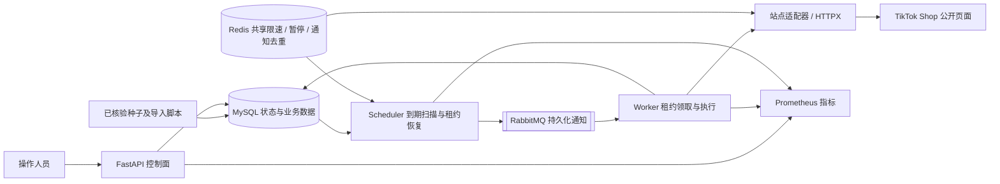

# 系统架构

本系统把美国站服装数据采集拆成控制面、持久化任务、通知调度、采集适配和业务存储。店铺、商品、SKU、历史快照、变化检测、显式名单周期调度及报告已落地；真实 Broker 故障联调已通过，长期运行尚未验收。

注意：自动采集默认关闭，100 条种子入口不变。运行层初始化不执行网站任务；2026-10-14 的显式少量实跑已更新 6 条商品页任务并入库 120 个商品。没有新增数据库表，也没有改变已有中文注释和约束。

## 架构与数据流

图中适配器支持公开 SSR、匿名商品分页和 PDP 详情。快照 Worker 同事务保存有效商品/SKU 观察并创建本地变化检测任务；比较 Worker 使用历史数据，不需要访问网站。

报告 Worker 读取 MySQL 中的一致视图，生成内容摘要命名的 HTML、Markdown 和 JSON，将文件位置及摘要写入任务检查点后才确认消息。报告与比较可在网站请求暂停时执行。容器 API 与 Worker 共享 `report_exports` 卷，API 只读挂载，保证下载能找到 Worker 生成的文件。

## 模块职责

| 模块 | 主要入口 | 职责 | 不负责 |
| --- | --- | --- | --- |
| 配置 | `app/settings.py` | TOML 配置校验、env 密钥读取、市场和能力开关 | 保存密码到 TOML |
| 控制面 | `app/main.py`、`app/api/routes.py` | 查询数据、任务状态、有限任务创建、健康检查 | 在 HTTP 请求内抓网站 |
| 调度器 | `app/services/scheduler.py` | 到期扫描、通知补发、租约恢复、显式名单周期快照 | 自动扩大商品监测范围 |
| 消息传输 | `app/queue/rabbitmq.py` | 持久化消息、确认发布、手动 ACK、死信路由 | 作为任务状态真相源 |
| 请求闸门 | `app/queue/redis_gate.py` | 跨 Worker 请求间隔、市场暂停、短期通知去重 | 作为永久去重和检查点存储 |
| 执行状态 | `app/services/task_runtime.py` | 领取、租约、心跳、重试、检查点、原子提交 | 解析站点字段 |
| Worker | `app/workers/runtime.py` | 驱动处理器、维持心跳、提交后确认消息 | 猜测缺失字段或调用未注册处理器 |
| 站点适配 | `app/adapters/tiktok_shop.py` | HTTPX 公开读取、接入共享闸门 | 身份绕过、账号登录、私有签名接口 |
| 业务服务 | `app/services/shop_discovery.py` 等 | 店铺确认、业务 Upsert、后续任务幂等创建 | 自行管理分布式租约 |
| 历史监测 | `snapshot_service.py`、`change_detector.py` | 不可变快照、已见 SKU、相邻有效观察的变化事件 | 把缺失/失败响应当作缺货或下架 |
| 报告 | `app/reports/`、`report_service.py`、`routes_reports.py` | 有界样本统计、离线导出、报告任务和下载 | 用采样推断全市场销量或排名 |
| 存储 | `app/models/`、`app/storage/` | 既有 10 表、事务、连接池、UTC 时间 | 用建表动作替代版本迁移 |
| 可观测性 | `app/observability/`、`monitoring/` | 脱敏日志、进程指标、任务积压和告警规则 | 伪造采集吞吐或持续运行成果 |

## 为什么 MySQL 是任务真相源

任务、尝试、检查点和业务结果都保存在 MySQL。RabbitMQ 只传三项：消息版本、任务 UUID 和任务类型，不传整段商品数据、Cookie 或密码。

1. API / 业务服务先在事务中保存任务。
2. Scheduler 扫描 `pending / retry_waiting / abandoned` 且已到期的任务，发布通知。
3. Worker 通过行锁领取任务，生成新的 `lease_token`，递增总尝试次数，并插入尝试记录。
4. HTTP 读取和解析发生在事务外，主线程维持 RabbitMQ 连接和 MySQL 租约心跳。
5. 结果提交时重新核验租约，将业务写入、检查点、尝试结果和任务状态一起提交。
6. SQL 提交后才 ACK；不可自动处理的失败先写成 `dead`，再将通知拒绝到死信队列。

本系统采用“至少一次通知 + 幂等领取/业务写入”，不宣称跨 MySQL 与 RabbitMQ 的 exactly-once。调度器重复扫描补偿提交后未发布的任务；Redis 仅减少短期重复消息，丢失或过期不会丢掉 MySQL 任务。

发布确认和消费确认是两个不同机制，分别用于确认消息进入 Broker 与处理完成。[RabbitMQ 确认机制](https://www.rabbitmq.com/docs/confirms)；断线恢复仍可能重复投递，因此接收端必须幂等。[RabbitMQ 可靠性说明](https://www.rabbitmq.com/docs/reliability)

调度扫描保留优先级和内部 ID 游标，每轮限制扫描与发布数量，避免反复停留在同一组已通知的高优先级任务。该实现适用于当前规模；若任务规模显著扩大，应测量扫描成本，再增加独立 outbox 或更专门的调度索引，而不是假定现有实现已通过大规模压测。

## 处理器能力边界

| 任务类型 | 状态 | 运行开关 |
| --- | --- | --- |
| `shop_discovery` | 已接入公开来源读取、身份解析、原子提交及商品发现任务创建 | 默认关闭，可显式启用 |
| `product_discovery` | 已接入首屏、原生分页、严格解析、商品 Upsert、下一页及详情任务 | 默认关闭，可显式启用 |
| `product_detail` | 已接入 PDP、SKU 规格、价格和可售状态，幂等事务与查询 | 默认关闭，可显式启用 |
| `product_snapshot` | 已接入同源商品/SKU 快照、窗口幂等与比较任务创建 | 默认关闭，可显式启用 |
| `change_detection` | 已接入价格、缺补货、折扣、规格和商家内容比较 | 默认关闭，可显式启用 |
| `report_generation` | 已接入样本统计、HTML/Markdown/JSON 导出、任务检查点与下载 | 默认关闭，可显式启用 |

`handler_registry()` 是实现注册表；`enabled_task_types` 是部署开关。启动时验证两者一致：没有实现的任务类型即使写入配置也会拒绝启动，不会把未完成任务标记成功。

Worker 的 `--check` 和控制面 `/api/v1/capabilities` 可以查看上述边界。

## 接入下一个采集器

按依赖方向扩展，不改动通用调度器和消息协议：

1. 在少量真实店铺上核实公开商品入口、分页、商品/店铺 ID 和价格上下文，保存脱敏样本。
2. 在适配器中实现读取与解析；每个 HTTP 请求，包括重定向，必须经过共享闸门。
3. 实现 `TaskHandler.prepare(lease, context)`，返回 `ExecutionResult`。网络读取在 `prepare` 中完成；数据库业务写入放入 `apply(session, task)`。
4. 在 `apply` 中执行商品业务键 Upsert 与下一步任务创建。使用同一事务，不自行提交，不操作租约和尝试次数。
5. 长分页任务通过 `save_checkpoint` 在自己的短事务中保存进度，必须带当前租约；不把 Redis 游标作为唯一进度证据。
6. 先完成真实样本解析、重复写入、结构漂移、空值和恢复验证，再注册处理器并显式启用任务类型。

接口定义在 `app/workers/contracts.py`，当前可参考 `ShopDiscoveryHandler`。不会提供虚构商品结果或“返回成功”的空采集器。

## 价格与库存语义

这些规则继承既有数据模型，后续采集器必须遵循：

- 商品价格为范围，保留 `price_min / price_max`；SKU 价格才是明确单价。
- 默认币种 `USD`，价格上下文 `public_listed`；登录优惠、优惠券价与公开标价不得混比。
- 不可见的库存、销量、评分为 `NULL / unknown`，不能用 0 代替。
- 商品、店铺及 SKU 的平台 ID 按字符串保留，不能转成 JavaScript 浮点数字。
- 任务重试不改变 `scheduled_for`；同一逻辑窗口的快照使用唯一约束保护。
- 限流、认证页面或验证码不是商品下架证据。

## 部署边界

本地 API 可复用已经配置的现有 MySQL。容器栈使用独立命名卷中的 MySQL，不会自动复制本地店铺、任务或种子。

API、Scheduler、Worker 是同一代码库的三个独立进程，不是三个独立数据库。Worker 可水平增加，仍需经过同一 Redis 闸门；增加 Worker 数量不等于提高目标站请求配额。

Compose 只将 API、RabbitMQ 管理页和 Prometheus 绑定到宿主机回环地址，MySQL、Redis、AMQP 不映射宿主机端口。读取 API 默认不要求 Token，仅适合本机或可信内部网络；对外开放前必须补齐鉴权、TLS 与网络访问控制。

## 验证边界

架构验证记录见[运行说明](runtime-guide.md)，采集及历史证据见[商品发现](product-discovery.md)、[详情](product-detail.md)和[历史监测](snapshot-monitoring.md)。已验证 3 店 6 页、3 个详情商品以及两次真实观察间的 1 条 SKU 缺货事件；报告及真实队列故障证据见[报告说明](monitoring-reports.md)和[队列联调](queue-integration.md)。尚未验证容器整体运行、多节点压力测试或持续监测。

证据 → 结论 → 下一步：

- 独立 MySQL 的多 Worker 竞争、租约恢复和回滚验证 → 持久化任务骨架可运行 → 接入经过采样的商品处理器。
- 独立 Redis 的共享请求间隔、暂停与发布令牌验证 → 请求闸门可执行 → 实际运行时所有适配器复用同一市场作用域。
- 真实本地库的只读 API / dry-run → 任务、商品和分页进度可核对 → 保持默认关闭，显式选择实跑范围。
- 真实 RabbitMQ 的持久化、重复投递、断线重投、Broker 重启、故障租约恢复和死信均通过 → 当前任务链路可在已验证故障下恢复 → 在有限名单上开展持续运行和完整容器栈验收。
- Compose 配置解析通过，报告共享卷已配置 → 确认部署配置结构有效 → 镜像构建、完整容器启动和多实例运行仍需实际验证。
